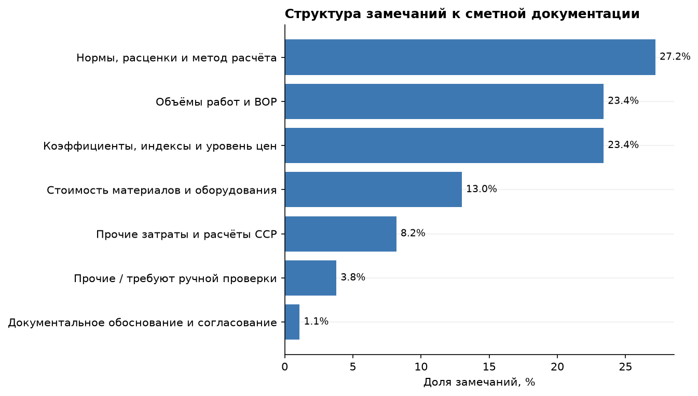
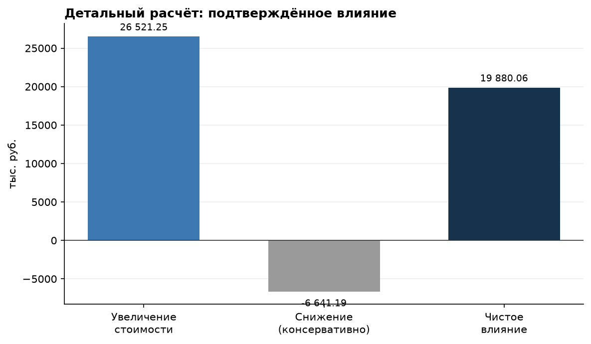
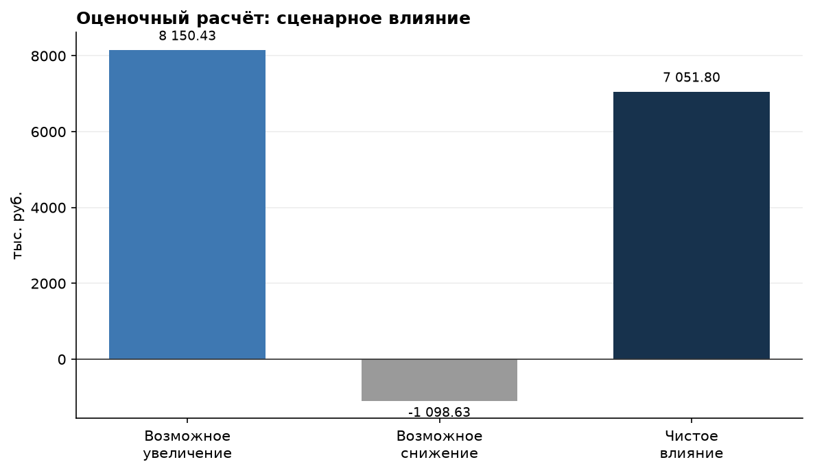
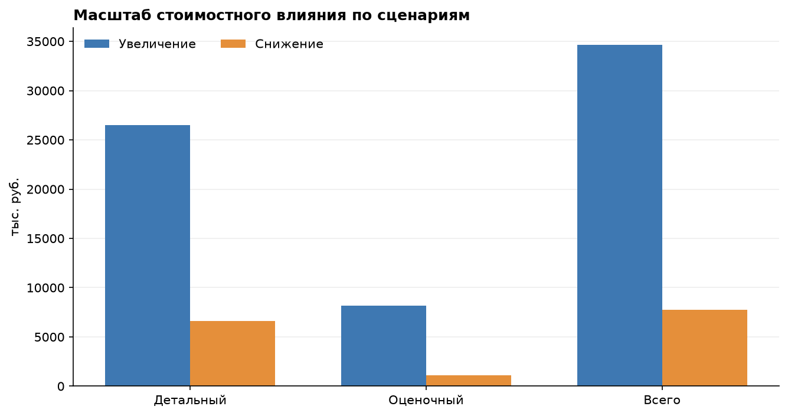

<div align="center">

# Проверка проектно-сметной документации при капитальном ремонте

### Воспроизводимый Python-анализ по объекту 1У-151 Астраханского ГПЗ

<p>
  
  
  
  
</p>

<p>
  <a href="reports/analysis_report.md">Итоговый отчёт</a> ·
  <a href="notebooks/01_smeta_audit.ipynb">Jupyter Notebook</a> ·
  <a href="docs/methodology.md">Методология</a> ·
  <a href="docs/source-audit.md">Аудит источника</a>
</p>

</div>

## О проекте

Проект переводит расчётную часть ВКР «Особенности формирования и проверки проектно-сметной документации при капитальном ремонте объектов нефтегазового комплекса» из Excel в понятный воспроизводимый Python-пайплайн.

Объект исследования — установка получения элементарной (газовой) серы 1У-151 Астраханского ГПЗ. Python-код повторяет формулы трёх релевантных листов исходной книги: командирование работников, перевозка работников и специальные мероприятия по обеспечению нормальных условий труда. Отдельно собран аналитический слой по 184 замечаниям к сметной документации.

Проект рассчитан на портфолио аналитика данных: здесь есть импорт исходных данных, контроль качества, расчёты, агрегации, визуализация, отчёт и тесты.

## Результаты анализа

| Показатель | Значение |
|---|---:|
| Замечания в исходном массиве | **184** |
| Замечания с потенциальным стоимостным влиянием | **113** |
| Детальный расчёт | **16 замечаний** |
| Оценочный расчёт | **97 замечаний** |
| Подтверждённое консервативное чистое влияние | **+19 880,06 тыс. руб.** |
| Расширенное влияние с оценочной частью | **+26 931,86 тыс. руб.** |

Подтверждённый результат показывает риск недоучёта затрат в исходной смете. Оценочный результат вынесен отдельно, потому что для 97 замечаний в ВКР требуются дополнительные первичные данные.

## Визуальный отчёт

<table>
  <tr>
    <td width="50%"></td>
    <td width="50%"></td>
  </tr>
  <tr>
    <td width="50%"></td>
    <td width="50%"></td>
  </tr>
</table>

Контекстное изображение объекта взято из презентации ВКР и сохранено с указанием происхождения: [context_plant.png](reports/figures/context_plant.png).

## Быстрый запуск

```bash
git clone <URL-репозитория>
cd smeta-audit-1u151

python -m venv .venv
source .venv/bin/activate       # macOS / Linux

python -m pip install -e ".[dev]"
smeta-audit run
```

После запуска обновляются:

- `reports/figures/` — четыре графика;
- `reports/analysis_report.md` — итоговый отчёт;
- `reports/excel_reproduction_python.csv` — результаты Python-расчётов;
- `reports/verification_summary.json` — ключевые суммы.

Проверка проекта:

```bash
ruff check .
pytest -q
```

## Что перенесено из Excel

| Лист исходной книги | Python-результат, тыс. руб. | Сохранённый результат Excel, тыс. руб. |
|---|---:|---:|
| Командировка | 9 482,755 | 9 482,755 |
| Перевозка | 708,760 | 708,760 |
| Гнус | 94,720 | 94,720 |
| Разница электроэнергии (legacy) | 41 701,279 | 41 701,279 |

Последний лист воспроизведён для аудита, но не включён в основной результат: он относится к другому объекту («КС Дивенская») и уровню цен 01.01.2017. В самой книге также есть legacy-листы с повреждёнными ссылками `#REF!`; они явно отмечены в [аудите источника](docs/source-audit.md).

## Структура проекта

```text
.
├── data/
│   ├── source/              # обезличенные входы и параметры формул
│   └── processed/           # таблицы замечаний, результатов и аудита
├── docs/                    # методология и решения по качеству данных
├── notebooks/               # пошаговый разбор для портфолио
├── reports/                 # графики, отчёт и результаты сверки
├── src/smeta_audit/
│   ├── calculations.py      # перенос формул Excel в типизированные функции
│   ├── analysis.py          # агрегация детального и оценочного расчёта
│   ├── pipeline.py          # единый запуск, графики и markdown-отчёт
│   └── cli.py               # команда smeta-audit run
└── tests/                   # тесты формул и контрольных итогов
```

## Методология

Для детального расчёта используется знак направления влияния:

```text
увеличение стоимости = добавление недоучтённой суммы
снижение стоимости  = исключение завышенной суммы
чистое влияние      = увеличение − снижение
```

Для листа командирования Python повторяет последовательность Excel: число циклов работы и отдыха, железнодорожный проезд, суточные, автобусный трансфер и проживание. Для листа перевозки рассчитываются число рейсов, длительность цикла, машино-часы и стоимость. Для листа «Гнус» отдельно считаются защитные шляпы и репелленты.

## Ограничения и честная работа с источником

- Исходная книга смешивает расчёты по 1У-151 и старый блок по КС Дивенская. Перед переносом выполнен аудит листов, дат и ссылок.
- Сумма строк таблицы 36 ВКР отличается от опубликованного итога на 0,01 тыс. руб. из-за независимого округления. В проекте сохранены и строковая сумма, и опубликованный итог.
- Расчёты Excel дают 9 482,755 тыс. руб. по командированию, 708,760 тыс. руб. по перевозке и 94,720 тыс. руб. по гнусу, тогда как в сводной таблице ВКР указаны 9 937,93; 742,78 и 99,27 тыс. руб. Расхождение не скрывается и требует сверки исходных редакций смет.
- Исходные DOCX/PPTX/XLS и персональные метаданные в репозиторий не включаются. В репозитории хранятся только обезличенные параметры, таблицы и производные результаты.

## Источники

- Пояснительная записка Бунтина В. Р. по ВКР, 2026.
- Презентация к ВКР, 2026.
- `Итоговый_расчет.xls` — рабочий источник расчётных листов.

Проект учебный и предназначен для демонстрации навыков аналитики данных, контроля качества и воспроизводимых расчётов.
